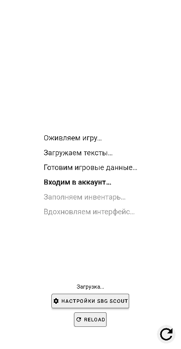
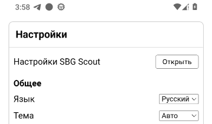
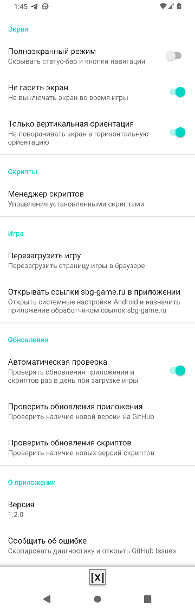
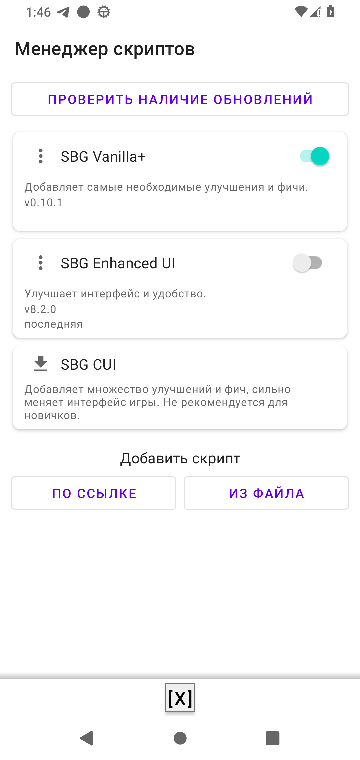

#  SBG Scout

[![Latest release][release-badge]][releases]
[![Release date][release-date-badge]][releases]
[![Downloads][downloads-badge]][releases]
[![Downloads@latest][downloads-latest-badge]][releases]
[![SBG][sbg-badge]][sbg]

[![Build status][ci-badge]][ci]
[![License MIT][license-badge]][license]

Android-клиент для игры [SBG](https://sbg-game.ru/) со встроенным менеджером юзерскриптов.

## Возможности

- **Встроенные скрипты** — Vanilla+ активен сразу после установки, EUI и CUI ставятся одним кликом; любой сторонний скрипт добавляется по URL или из файла, переключается и обновляется в менеджере
- **Автообновление** — приложение и скрипты проверяются раз в день при запуске, release notes показываются в диалоге
- **Обработка ссылок sbg-game.ru** — если назначить SBG Scout обработчиком по умолчанию (кнопка в настройках ведёт на нужный системный экран Android одним тапом), ссылки на игру из других приложений будут открываться в SBG Scout
- **Переключение на бета-версию игры** — для приглашённых в бета-программу: 5 нажатий на пункт «Версия» в настройках открывают диалог переключения между `sbg-game.ru` и `beta.sbg-game.ru`, после подтверждения страница игры перезагружается с выбранного хоста

## Скачать

[Скачать последний APK][releases-latest]

## Требования

- Android 8.0+ (API 26)
- Для сборки: JDK 17 (компиляция), JDK 21 (Gradle daemon), Android SDK 35. Gradle может загрузить toolchain автоматически; см. [подготовку окружения](docs/agent-setup.md).

## Скриншоты

<table>
<tr>
<td valign="top"></td>
<!-- 🤖 Generated with Claude Opus 5.5 -->
<td valign="top"></td>
</tr>
<tr>
<td valign="top"></td>
<td valign="top"></td>
</tr>
</table>

## Сборка

```bash
./gradlew assembleDebug
```

## Проверка

```bash
./gradlew ktlintCheck detekt lintInstr testInstrUnitTest assembleDebug assembleInstr assembleRelease
```

В PowerShell использовать `./gradlew.bat` с теми же аргументами. E2e запускаются отдельно через `connectedInstrAndroidTest` на эмуляторе.

## Работа с Codex и Claude Code

Общие правила — в [AGENTS.md](AGENTS.md); Claude Code загружает их через [CLAUDE.md](CLAUDE.md).
Скиллы хранятся в `.agents/skills/`, копии для Claude Code обновляются командой `node scripts/syncAgentSkills.mjs`.
Они уже включены в репозиторий, установка и симлинки не нужны. После первого открытия или добавления скиллов начать новую сессию, если список ещё не обновился.

| Сценарий | Codex | Claude Code |
|---|---|---|
| Проверка проекта | `$scout-verify` | `/scout-verify` |
| Скриншоты README | `$scout-screenshots` | `/scout-screenshots` |
| Подготовка release PR | `$scout-release` | `/scout-release` |
| Анонс изменений | `$scout-announce 1.2.0` | `/scout-announce 1.2.0` |

Release Please предлагает версию в release PR; агент готовит в нём русские notes
и три скриншота. CI сверяет версию заголовка notes. После проверок и review
squash merge создаёт тег и draft, затем публикуется проверенный подписанный APK.
Подготовка PR сама по себе не разрешает выпуск.

Подробности: [окружение, preview и релизы](docs/agent-setup.md).

## Документация

- [Архитектура](docs/architecture.md)
- [Принципы разработки](docs/dev-principles.md)
- [Стиль кода](docs/codestyle.md)

[releases]: https://github.com/wrager/sbg-scout/releases
[releases-latest]: https://github.com/wrager/sbg-scout/releases/latest
[ci]: https://github.com/wrager/sbg-scout/actions/workflows/ci.yml
[license]: LICENSE
[sbg]: https://sbg-game.ru/app
[release-badge]: https://img.shields.io/github/v/release/wrager/sbg-scout?style=flat-square
[release-date-badge]: https://img.shields.io/github/release-date/wrager/sbg-scout?style=flat-square
[ci-badge]: https://img.shields.io/github/actions/workflow/status/wrager/sbg-scout/ci.yml?branch=main&style=flat-square
[downloads-badge]: https://img.shields.io/github/downloads/wrager/sbg-scout/total?style=flat-square&cacheSeconds=3600
[downloads-latest-badge]: https://img.shields.io/github/downloads/wrager/sbg-scout/latest/total?style=flat-square&cacheSeconds=3600&label=downloads%40latest
[license-badge]: https://img.shields.io/github/license/wrager/sbg-scout?style=flat-square
[sbg-badge]: https://img.shields.io/website?label=sbg-game.ru/app&style=flat-square&url=https%3A%2F%2Fsbg-game.ru/app
